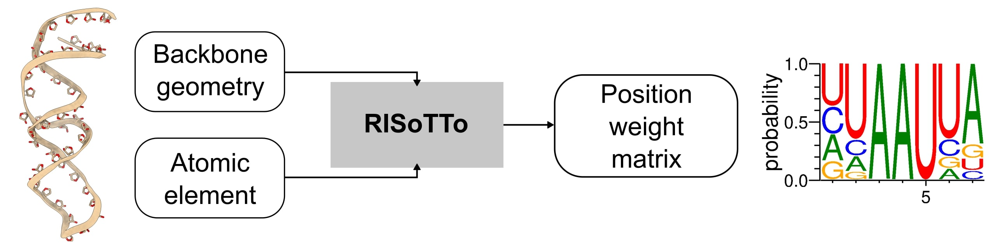

# RISoTTo

RISoTTo (RIbonucleic acid Sequence design from TerTiary structure) is a parameter-free geometric deep learning approach that generates RNA sequences conditioned on both their backbone scaffolds and the surrounding molecular context. This repository contains the code to design RNA sequences that are predicted to fold into a given target structure, to train the model, and to reproduce the figures of the paper.

## System requirements

### Operating system

Tested on **Ubuntu 22.04.5 LTS** (Linux kernel 6.8.0). Any Linux distribution supported by PyTorch should work. A C++ compiler and `make` are only needed to build EternaFold (tested with gcc 11.4.0 and GNU Make 4.3).

### Hardware

No non-standard hardware is required: RISoTTo runs on a CPU. An NVIDIA GPU makes it faster.

Tested on a desktop with an Intel Core i7-12700K, 62 GB of RAM and an NVIDIA GeForce RTX 4070 (12 GB, driver 580.178.04, CUDA 12.1). Large complexes need more GPU memory: `test_pdb/8wf9.pdb` (about 9,800 atoms) peaks at 8.8 GB. On a 12 GB GPU it only fits with `PYTORCH_CUDA_ALLOC_CONF=expandable_segments:True`.

### Software dependencies

Tested with **Python 3.11.8** and the versions below, which are pinned in `requirements.txt`:

| package | version | used for |
|---|---|---|
| torch | 2.3.1 (CUDA 12.1 build) | model |
| numpy | 1.26.4 | |
| scipy | 1.13.1 | |
| pandas | 2.2.2 | |
| h5py | 3.13.0 | training dataset |
| gemmi | 0.6.6 | structure parsing |
| scikit-learn | 1.5.0 | training metrics |
| tqdm | 4.66.4 | |
| biotite | 1.2.0 | native 2D structures (benchmark) |
| matplotlib | 3.9.0 | figures |
| seaborn | 0.13.2 | figures |
| tensorboard | 2.17.1 | training logs |
| parmed | 4.3.0 | `scripts/cif_to_pdb.py` |
| notebook / nbconvert / ipykernel | 7.2.2 / 7.16.4 / 6.29.4 | notebooks |

Optional external software:
- [EternaFold](https://github.com/eternagame/EternaFold) (git submodule at commit `13d2487`): 2D self-consistency in the benchmark.
- [AlphaFold3](https://github.com/google-deepmind/alphafold3) (singularity container, input JSON dialect `alphafold3` version 2): folding of the designed sequences (`scripts/run_af3.job`). This is only needed to regenerate the AF3 predictions, which are provided.

## Installation

```bash
git clone --recurse-submodules https://github.com/LBM-EPFL/RISoTTo.git
cd RISoTTo
conda create -n risotto python=3.11 -y   # or: python3.11 -m venv risotto
conda activate risotto                   #     source risotto/bin/activate
pip install -r requirements.txt
```

`pip` installs the CUDA 12.1 build of PyTorch on Linux. For other CUDA versions or CPU-only machines, first install the matching `torch==2.3.1` build following [pytorch.org](https://pytorch.org/get-started/previous-versions/).

Optional: build EternaFold (only needed to recompute the 2D self-consistency of the benchmark):

```bash
git submodule update --init software/EternaFold   # if not cloned with --recurse-submodules
cd software/EternaFold/src && make && cd -
```

**Typical install time:** about 3 minutes on a normal desktop computer with a broadband connection. A clean `pip install -r requirements.txt` took 155 s, most of it downloading PyTorch and its CUDA libraries (about 6 GB on disk).

## Demo

```bash
python apply_model.py --pdb_filepath=test_pdb/1csl.pdb --output_dir=demo/ --num_samples=5 --imprint_ratio=0.5 --device=cuda --sampling=max_confidence
```

Use `--device=cpu` without a GPU. This writes `demo/1csl_designs.fasta`:

```
>seq_wt | imprint_ratio=0.5 sampling=max_confidence
AACGGGCGCAGAAUCUGACGGUACGUUU
>seq_0 | recovery=0.321 confidence=0.958
UGCUGUACAUGGGCCAGAGGAACGGCUA
>seq_1 | recovery=0.286 confidence=0.979 recover_max_conf=0.964
UGCUGUACAUGGGCCAGAGUAACGGCUA
...
```

`seq_wt` is the native sequence and `seq_0` is the maximum-confidence design. It is the same in every run, and the expected output is in `test_pdb/1csl_designs.fasta`. `seq_1` to `seq_5` are sampled and differ between runs. `recovery` is the sequence identity to the native sequence, `confidence` is the mean predicted confidence, and `recover_max_conf` is the identity to `seq_0`.

**Expected run time:** about 2 s on the GPU and 7 s on the CPU of the test machine, including loading the model.

## Usage

```bash
python apply_model.py \
    --pdb_filepath path/to/structure.pdb \
    --output_dir ./output \
    --num_samples 5 \
    --imprint_ratio 0.5 \
    --sampling probabilistic \
    --device cuda:0
```

- `--pdb_filepath` (required): PDB file of the RNA structure, including any molecular context (proteins, nucleic acids, ligands, ions)
- `--output_dir` (required): directory for the output FASTA file
- `--num_samples` (default: 5): number of sequences sampled in addition to the maximum-confidence sequence
- `--imprint_ratio` (default: 0.5): fraction of residues constrained during sampling (0.0-1.0)
- `--sampling` (default: `max_confidence`): sampling method (`max_confidence` or `probabilistic`)
- `--device` (default: `cuda:0`): device for computation (`cuda:0`, `cpu`, ...)

## Training

Download the ML-ready dataset from [Google Drive](https://drive.google.com/file/d/1Ihp-RgOw6GUoTmV1lKFPmRRjOEMJZBH8/view?usp=sharing). Set `dataset_filepath` in `config.py` to its location, then run:

```bash
python main.py
```

The training, validation and test splits are in `datasets/`. The trained model used in the paper is in `save/`. Its confidence calibration (`results/save_cdf.csv`) is computed with `define_confidence_map.ipynb`.

## Reproducing the paper figures

The benchmark figures (sequence recovery, 2D self-consistency, AlphaFold3 RMSD and pLDDT for RISoTTo, gRNAde and RhoDesign) and the molecular context figure (sequence recovery at RNA interfaces) are reproduced by the notebooks in `paper/`. They write each figure to `paper/figures/` as PNG, SVG and PDF.

**1. Figures from the precomputed metric tables** (a few seconds):

```bash
cd paper
jupyter nbconvert --to notebook --execute --inplace fig_benchmark.ipynb
jupyter nbconvert --to notebook --execute --inplace fig_context_interfaces.ipynb
```

**2. Recompute the metric tables from the raw data:**

1. Download `risotto_paper_raw.tar.gz` from Zenodo (DOI: _to be added_) and extract it in `paper/` (`tar -xzf risotto_paper_raw.tar.gz` creates `paper/raw/`). It contains the native structures and the AlphaFold3 inputs, models and confidences of the designs.
2. Build EternaFold (see Installation).
3. Benchmark: set `RECOMPUTE = True` in `paper/fig_benchmark.ipynb` and run it. This takes about 1 min on the test machine.
4. Molecular context: run the following from the repository root. It takes about 30 s on the test GPU and is deterministic.
   ```bash
   python test_model_context.py --pdb_dir paper/raw/native_pdbs --output_dir paper/data/context_interfaces_rerun
   ```

The AlphaFold3 predictions were produced with `scripts/prepare_af3.py` and `scripts/run_af3.job`. See [`paper/README.md`](paper/README.md) for details on the data and notes on reproducibility.

## Repository structure

```
RISoTTo/
├── apply_model.py               # design sequences for a structure (inference)
├── runtime.py                   # model wrapper, structure loading, metrics (RMSD, TM-score, ...)
├── test_model_context.py        # sequence recovery at RNA interfaces with/without context
├── evaluate_model.py            # design the test set (writes predictions/)
├── main.py                      # training
├── config.py                    # training configuration
├── model.py                     # model architecture (training)
├── data_handler.py              # training dataset loader
├── build_structures_dataset.py  # build the HDF5 training dataset from PDB files
├── define_confidence_map.ipynb  # confidence calibration -> results/save_cdf.csv
├── theme.py                     # plot colours
├── requirements.txt
├── src/                         # structure processing, encoding and model layers
│   ├── data_encoding.py
│   ├── dataset.py
│   ├── geometry.py
│   ├── logger.py
│   ├── model_operations.py
│   ├── molecule_templates.py
│   ├── scoring.py
│   ├── structure.py
│   ├── structure_analysis.py
│   └── structure_io.py
├── save/                        # trained model used in the paper
│   ├── __init__.py
│   ├── config.py
│   ├── model.py
│   ├── model.pt
│   └── model_ckpt.pt
├── results/
│   ├── save_cdf.csv             # confidence calibration of the trained model
│   └── confidence_mapping_save.{png,svg}
├── datasets/                    # train / validation / test splits
│   ├── grnade_das_train_set.txt
│   ├── grnade_das_validation_set.txt
│   └── grnade_das_test_set.txt
├── predictions/                 # RISoTTo designs of the benchmark targets ({PDBID}.fasta)
├── test_pdb/                    # demo structures and expected outputs
│   ├── 1csl.pdb
│   ├── 1csl_designs.fasta
│   ├── 8wf9.pdb
│   └── 8wf9_designs.fasta
├── scripts/                     # AlphaFold3 folding of the designs
│   ├── prepare_af3.py
│   ├── run_af3.job
│   ├── af_input_template.json
│   └── cif_to_pdb.py
├── software/
│   └── EternaFold/              # git submodule
└── paper/                       # reproduction of the paper figures
    ├── README.md
    ├── fig_benchmark.ipynb
    ├── fig_context_interfaces.ipynb
    ├── benchmark_lib.py
    ├── build_raw_archive.py     # assembles the Zenodo raw-data archive
    ├── data/                    # metric tables behind the figures
    │   ├── grnade_full_benchmark.csv
    │   ├── recovery_sc_comparison_risotto_grnade_rhodesign.csv
    │   ├── rmsd_gddt_tm_comparison_risotto_grnade_rhodesign.csv
    │   └── context_interfaces/  # {PDBID}.csv per-interface results
    ├── figures/                 # generated figures
    └── raw/                     # raw data from Zenodo (not in git)
```

## License

This work is licensed under a
[Creative Commons Attribution-NonCommercial-ShareAlike 4.0 International License][cc-by-nc-sa].

[![CC BY-NC-SA 4.0][cc-by-nc-sa-image]][cc-by-nc-sa]

[cc-by-nc-sa]: http://creativecommons.org/licenses/by-nc-sa/4.0/
[cc-by-nc-sa-image]: https://licensebuttons.net/l/by-nc-sa/4.0/88x31.png
[cc-by-nc-sa-shield]: https://img.shields.io/badge/License-CC%20BY--NC--SA%204.0-lightgrey.svg

## Reference
Bibekar, P., Krapp, L. F., & Dal Peraro, M. (2025). Context-aware geometric deep learning for RNA sequence design. bioRXiv https://doi.org/10.1101/2025.06.21.660801
